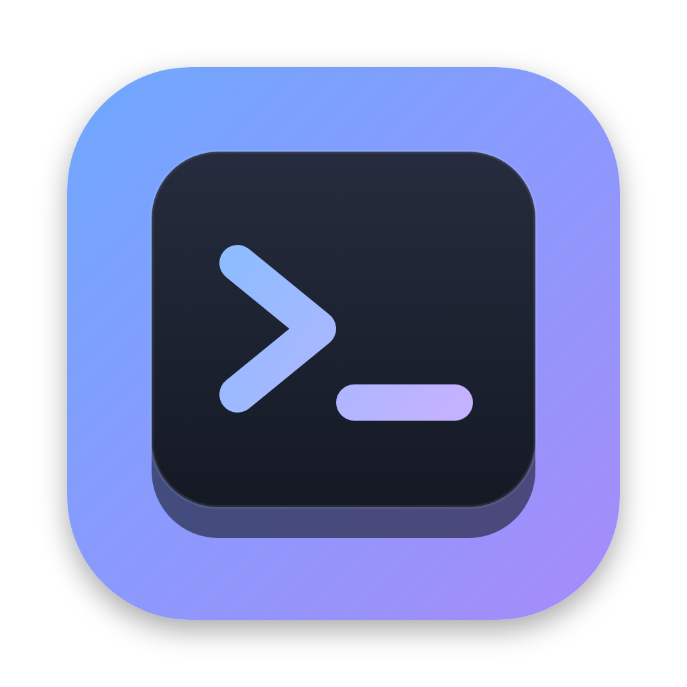
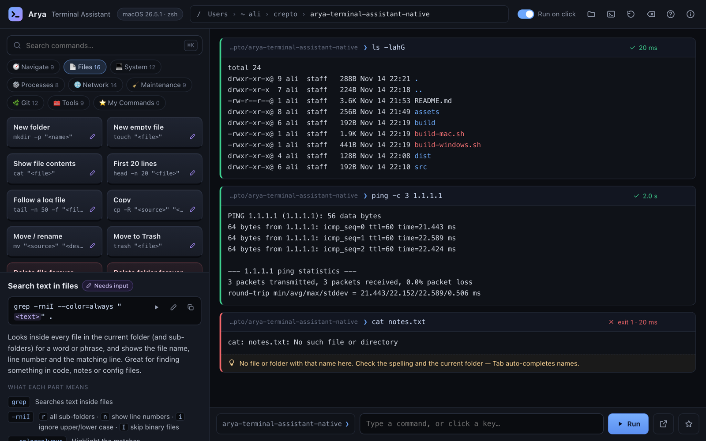
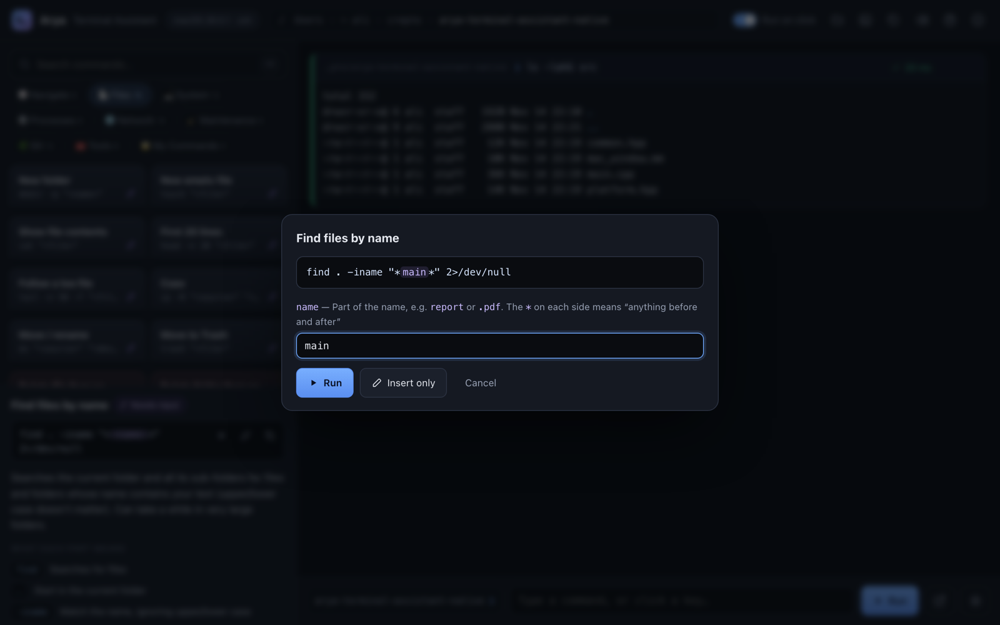
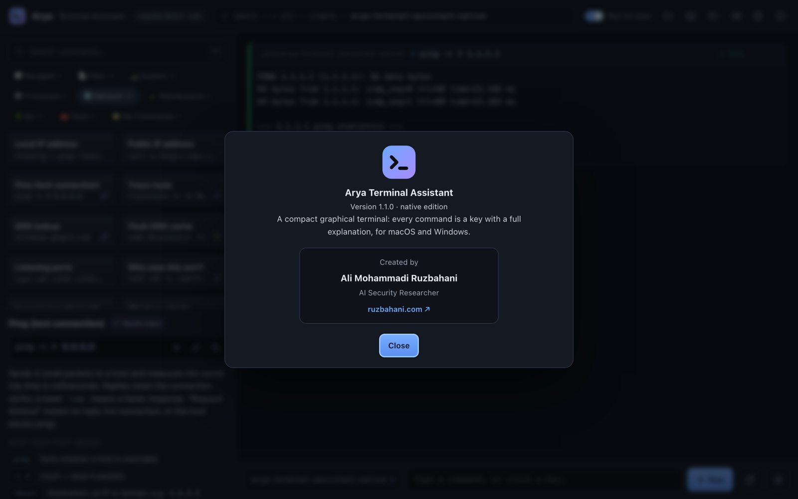
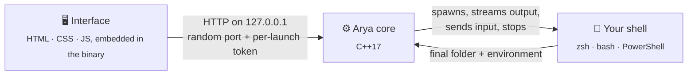

<div align="center">



# Arya Terminal Assistant

### The terminal, turned into a keyboard of explained commands.

Click a key and the command is typed into your real shell and runs.<br>
Hover it and see exactly what every part of it does.

[](LICENSE)
[](#-download)
[](#-build-from-source)
[](#-how-it-works)

**[Download](#-download)** &nbsp;·&nbsp; **[Features](#-features)** &nbsp;·&nbsp; **[Commands](#-the-command-library)** &nbsp;·&nbsp; **[How it works](#-how-it-works)** &nbsp;·&nbsp; **[Build](#-build-from-source)** &nbsp;·&nbsp; **[Customize](#-make-it-yours)**

<br>



</div>

<br>

## Why Arya?

The command line is the most powerful tool on your computer, and the least friendly one.
Arya keeps all of that power and removes the guesswork:

- **No memorizing.** 92 everyday commands sit on a keyboard of keys, grouped by what you want to do.
- **No mystery.** Every key explains what the command does, what each flag means, and what the
  equivalent is on the other operating system.
- **No fake terminal.** Commands run in your real shell, with real output, so you learn the real thing.
- **No installation.** One small native executable. No Python, no Node, no runtime, nothing else.

<br>

## ✨ Features

|   |   |
| --- | --- |
| 🎹 **Commands as keys** | 92 commands in 8 categories, searchable with <kbd>⌘K</kbd> / <kbd>Ctrl K</kbd>. |
| 📖 **Fully explained** | Plain-English description, a breakdown of every part of the command, and the macOS ⇄ Windows equivalent. |
| ✍️ **Smart inputs** | Keys that need a file name, a host or a port open a small form with a live preview of the final command. |
| 🛡️ **Safety first** | Dangerous commands are marked and ask for confirmation, and destructive commands you type yourself are caught too. |
| 🖥️ **A real shell** | zsh / bash on macOS, Windows PowerShell on Windows. `cd`, `export` and Python virtual environments carry over between commands. |
| 🎨 **Real terminal output** | ANSI colors, live progress bars, exit codes, timings, and one-click copy or re-run of any result. |
| 💡 **Friendly errors** | “command not found”, “permission denied”, missing files, unknown hosts, busy ports… explained in plain English. |
| ⌨️ **Keyboard friendly** | History with <kbd>↑</kbd> <kbd>↓</kbd>, file-name completion with <kbd>Tab</kbd>, <kbd>Ctrl C</kbd> to stop, answer prompts of running programs. |
| ⭐ **Your own keys** | Save any command as a key, with inputs (`<name>`, `<port=3000>`) and its own description. |
| 🔐 **Admin made simple** | `sudo` shows the native macOS password dialog. Commands that need Administrator rights on Windows open in an elevated window. |
| 🪟 **Interactive programs** | vim, nano, top, ssh and friends open automatically in a real terminal window. |
| 🪶 **Tiny and native** | ~0.6 MB on Windows, ~0.7 MB universal binary on macOS. A native window on macOS, an app window of the built-in Edge on Windows. |

<br>

<table>
  <tr>
    <td width="50%"></td>
    <td width="50%"></td>
  </tr>
  <tr>
    <td align="center"><sub>Inputs with a live preview of the final command</sub></td>
    <td align="center"><sub>About</sub></td>
  </tr>
</table>

<br>

## 📦 Download

Grab the latest build from **[Releases](https://github.com/ruzbahani/Arya-Terminal-Assistant/releases/latest)**.

| Platform | File | Needs |
| --- | --- | --- |
| 🍏 **macOS** 10.15 or later · Apple Silicon & Intel | `Arya-Terminal-Assistant-macOS.zip` | nothing |
| 🪟 **Windows** 10 / 11 · x64 | `Arya-Terminal-Assistant-Windows.exe` | nothing |

> [!NOTE]
> The builds are not signed with a paid developer certificate, so the first launch shows a warning.
> **macOS:** right-click the app → **Open**. &nbsp; **Windows:** **More info** → **Run anyway**.

<br>

## 🧭 The command library

| Category | Examples |
| --- | --- |
| 🧭 **Navigate** | Where am I? · List files · Go to folder · Folder tree · Open this folder |
| 📄 **Files** | New folder · Copy · Move / rename · Move to Trash · Find files · Search text in files · Zip / Unzip |
| 💻 **System** | OS version · Hardware · CPU · Memory · Battery health · Lock screen · Shut down / Restart |
| ⚙️ **Processes** | Top CPU / memory users · Find a running program · Close a program · Live resource monitor |
| 🌐 **Network** | Local & public IP · Ping · Trace route · DNS lookup · Listening ports · Who uses this port? · Wi-Fi |
| 🧹 **Maintenance** | Disk space · Folder sizes · Find big files · Disk health · Empty the Trash · Updates |
| 🌿 **Git** | Status · History · Changes · Stage · Commit · Pull / Push · Branches · Stash |
| 🧰 **Tools** | File checksum · Password generator · Clipboard · Share a folder on Wi-Fi · Keep awake · Weather |

Every command exists for both macOS (zsh) and Windows (PowerShell), and Arya shows the one that fits your system.

<br>

## ⌨️ Shortcuts

| Keys | Action |
| --- | --- |
| <kbd>Enter</kbd> | Run · send input to a running program |
| <kbd>Shift</kbd> + <kbd>Enter</kbd> | New line |
| <kbd>↑</kbd> <kbd>↓</kbd> | Previous / next command |
| <kbd>Tab</kbd> | Complete file and folder names |
| <kbd>Ctrl</kbd> + <kbd>C</kbd> | Stop the running command |
| <kbd>Ctrl</kbd> + <kbd>D</kbd> | End input for a running program |
| <kbd>Ctrl</kbd> + <kbd>L</kbd> | Clear the output |
| <kbd>⌘</kbd> / <kbd>Ctrl</kbd> + <kbd>K</kbd> | Search commands |
| <kbd>Shift</kbd> + click | Insert a key's command without running it |

<br>

## 🏗️ How it works



- **One executable.** The interface and the command library are compiled into the binary.
  On macOS it opens in a native window (WebKit); on Windows in an app window of Microsoft Edge, which ships with Windows.
- **A continuous session.** Every command runs in a fresh shell, and the final working folder and
  environment variables are handed to the next one, so `cd`, `export` and `source venv/bin/activate` just work.
- **Process control.** macOS uses process groups (Stop sends Ctrl+C first, then escalates);
  Windows uses Job Objects, so Stop ends the whole process tree.
- **Private by design.** The core only listens on `127.0.0.1`, on a random port, behind a secret token that
  changes on every launch, and rejects foreign `Host` headers. Nothing leaves your computer except what the
  commands you run do themselves.

<br>

## 🛠️ Build from source

**macOS** (needs Apple's command line tools: `xcode-select --install`)

```bash
./build-mac.sh
# → dist/macOS/Arya Terminal Assistant.app  (universal: arm64 + x86_64)
```

**Windows**, cross-compiled from macOS or Linux with [Zig](https://ziglang.org) (one portable download)

```bash
ZIG=/path/to/zig ./build-windows.sh
# → dist/Windows/Arya Terminal Assistant.exe
```

```text
src/
├── common.hpp      strings, UTF-8 and a small JSON library
├── platform.hpp    files, environment, processes (POSIX fork/exec · Win32 CreateProcess + Job Objects)
├── main.cpp        session, command runner, local API, lifecycle
└── mac_window.mm   native macOS window, menus, About panel, drag & drop
assets/
├── ui.html         the interface
├── commands.json   the command library
└── AppIcon.*       icons · app.rc (Windows resources)
```

No third-party libraries. Everything is plain C++17 plus the system APIs of each platform.

<br>

## 🎨 Make it yours

**Your own keys.** Type a command and press ☆, or open **⭐ My Commands → Add a command**.

**Your own library.** Copy `assets/commands.json` into Arya's data folder, edit it, and reload the window:

| | Data folder |
| --- | --- |
| macOS | `~/Library/Application Support/Arya Terminal Assistant/` |
| Windows | next to the `.exe` (portable), or `%APPDATA%\Arya Terminal Assistant\` |

Each command looks like this:

```json
{
  "cat": "net", "title": "Ping (test connection)",
  "mac": "ping -c 4 <host=8.8.8.8>",
  "win": "ping -n 4 <host=8.8.8.8>",
  "desc": "Sends 4 small packets to a host and measures the round-trip time.",
  "parts": { "<host>": "Destination: an IP or a domain, e.g. `google.com`" }
}
```

| Field | Meaning |
| --- | --- |
| `cat` · `title` · `desc` | Category id, key label and full explanation (`` `backticks` `` render as code) |
| `mac` · `win` · `all` | The command per system, or `all` when it is the same on both |
| `parts` | Explanation of each piece; keys must appear in the command exactly as written |
| `<name>` · `<name=default>` | An input asked for before running, optionally pre-filled |
| `danger` | `true` asks for confirmation before running |
| `admin` | `"win"` runs it in an elevated window on Windows |
| `term` | `true`, `"mac"` or `"win"` opens it in a separate terminal window |

**Development.** `ARYA_UI_FILE=/path/ui.html` loads the interface from disk instead of the embedded copy,
`ARYA_DATA_DIR` uses another data folder, `--no-browser` starts only the core, and a folder path as the
first argument sets the starting folder.

<br>

## 🤝 Contributing

Ideas, bug reports and new commands are welcome. Most improvements to the library are a few lines of JSON;
please include both the macOS and the Windows variant when you can.

<br>

## 📄 License

[MIT](LICENSE) © 2026 Ali Mohammadi Ruzbahani

<br>

<div align="center">

Made by **Ali Mohammadi Ruzbahani**

[ruzbahani.com](https://ruzbahani.com) &nbsp;·&nbsp; [GitHub](https://github.com/ruzbahani)

</div>
